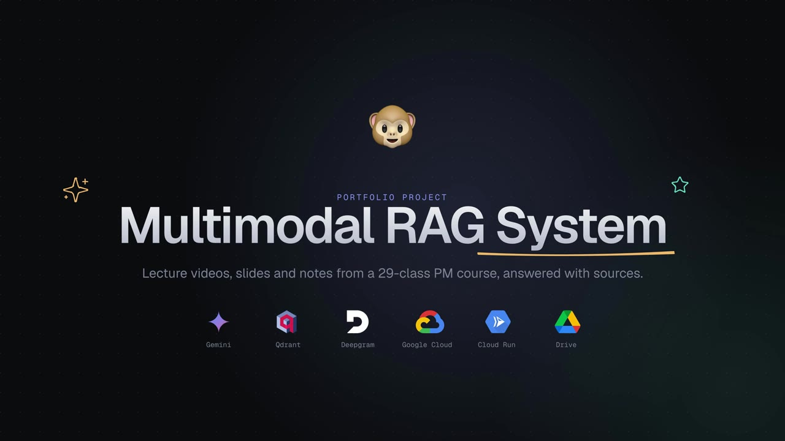
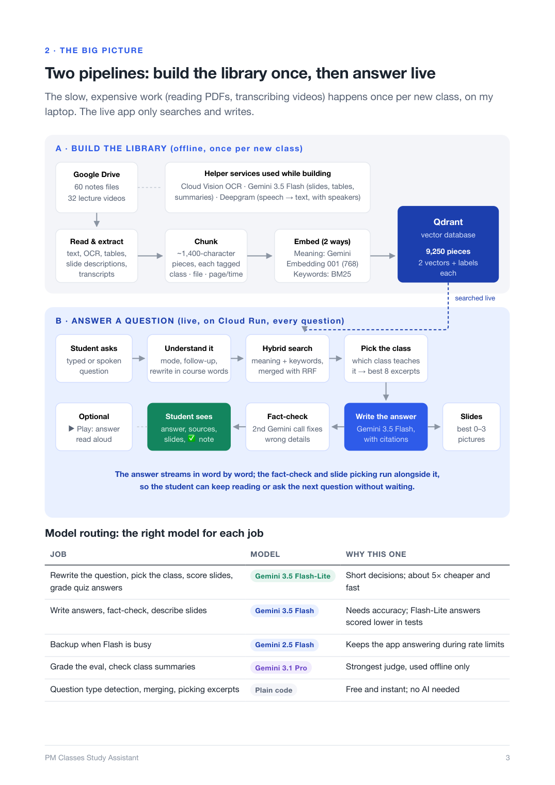

# PM Classes RAG Companion

**A multimodal RAG study companion that has "sat through" an entire product-management course.**
It answers questions from 66 hours of lecture recordings and 60 notes files, cites the exact notes page or lecture second each fact came from, fact-checks itself, and shows the matching slide.

Designed, built, evaluated and deployed end to end by **Aditya Sharan** (Oct 2026).

[](https://github.com/aaDhut/pm-classes-rag-companion-portfolio/releases/download/v1.0/Multimodal_RAG_System.mp4)

▶ **[Watch the 6-minute explainer video](https://github.com/aaDhut/pm-classes-rag-companion-portfolio/releases/download/v1.0/Multimodal_RAG_System.mp4)** · 📄 **[Read the 15-page system walkthrough (PDF)](docs/RAG_System_Explainer.pdf)**

> **Portfolio snapshot.** This repo is a frozen copy of the project as of 27 Oct 2026. The live app, the course recordings and notes, and all API keys stay private. Instructor names are replaced with "Instructor A/B".

---

## At a glance

| | |
|---|---|
| **Course covered** | 32 classes and workshops · 66.6 h of video · 60 PDFs, Docs and Sheets |
| **Search library** | 9,250 pieces (notes pages, timed transcript chunks, slides, class summaries) |
| **Accuracy** | **99.3%** of 3,748 claims correct on a 183-question test set, graded by Gemini 3.1 Pro |
| **Cost** | ≈ ₹3.5 (≈ $0.036) per question · ≈ ₹0 hosting when idle (Cloud Run scales to zero) |
| **Speed** | First word in ~12 s, answer streams word by word |

## What a student can do

- **Ask anything about the course.** Answers cite sources inline as [1], [2]; each is a notes page or a lecture moment.
- **Ask "where was this taught?"** Get links that open the lecture video at the exact second, plus the notes page.
- **Summarise** a class, a topic across every class that covered it, or the whole course.
- **Take a quiz.** Multiple-choice questions built from the class material, with fact-checked answer keys.
- **See the slide.** The best matching slides and screenshots appear next to the answer.
- **Speak and listen.** Ask by voice; press Play to hear the answer in an Indian-English voice.
- **Ask follow-ups** like "explain the second one", which resolve against the earlier conversation.

## How it works



**A · Build the library** (offline, once per new class): `ingest.py`
1. **Sync** new or changed files from Google Drive (read-only OAuth).
2. **Extract** text from PDFs, Docs, Sheets, PPTX and images. Image-only slides are OCR'd, big visuals get a Gemini description, and PDF tables are rebuilt as Markdown.
3. **Videos:** ffmpeg → **Deepgram Nova-3** (Hindi + English, speaker diarization) → screen frames kept on change → **Cloud Vision OCR** → Gemini names the speakers → timed lecture chunks, slide chunks and a fact-checked class summary.
4. **Chunk** (~1,400 chars, tagged class · file · page/time) and **embed twice**: dense `gemini-embedding-001` (768-d) plus sparse BM25 → **Qdrant**.

**B · Answer a question** (live, on Cloud Run)
1. **Understand:** detect the mode (Q&A, summary, quiz), resolve follow-ups, rewrite the question in course words.
2. **Hybrid search:** dense + BM25 merged with Reciprocal Rank Fusion; notes and lectures are interleaved so neither crowds out the other.
3. **Pick the class:** score each class's "heat" for the topic, then a Flash-Lite call decides which classes teach it (and flags when one word means different things in different classes).
4. **Answer** with Gemini 3.5 Flash, grounded only in the excerpts, with citations.
5. **Fact-check** every answer against its excerpts with a second Gemini call that fixes wrong details. In parallel, a scorer picks 0–3 slides that fit the question ("no picture beats a wrong one").

### Model routing

| Job | Model | Why |
|---|---|---|
| Rewrite query, pick class, score slides, grade quiz | Gemini 3.5 Flash-Lite | Short decisions; ~5× cheaper |
| Write answers, fact-check, describe slides | Gemini 3.5 Flash | Flash-Lite scored lower in tests |
| Fallback on rate limits | Gemini 2.5 Flash | Keeps the app answering |
| Grade the eval, check summaries | Gemini 3.1 Pro | Strongest judge, offline only |
| Mode detection, merging, excerpt picking | Plain Python | Free and instant |

## Evaluation: measured, not promised

The eval harness in [`eval/accuracy.py`](eval/accuracy.py) runs each test case through the full app, splits every answer into individual claims, and has Gemini 3.1 Pro grade each claim against the source material. It also measures retrieval precision/recall against hand-picked evidence and logs cost and latency per step. Full results and method: [`eval/RESULTS.md`](eval/RESULTS.md).

| Question type | Cases | Claims | Accuracy |
|---|---|---|---|
| Facts | 71 | 1,004 | 99.6% |
| Class summaries | 32 | 1,586 | 99.6% |
| Numbers | 20 | 244 | 100% |
| Tables | 12 | 154 | 99.4% |
| "Where was it taught" | 10 | 109 | 100% |
| Follow-ups | 12 | 196 | 92.3% |
| Quiz, pictures, topic summaries, not-covered, … | 26 | 455 | 99.8% |
| **Total** | **183** | **3,748** | **99.3%** |

Cost decisions were tested the same way. For example, lowering the fact-checker's thinking budget kept accuracy level (95.9% vs 95.6% on a 50-question set) while cutting cost per answer by 31% and check time from 10 s to 4 s, so it shipped. Switching answers to Flash-Lite dropped accuracy to 93.5%, so it didn't.

## Tech stack

**AI:** Gemini 3.5 Flash / Flash-Lite / 3.1 Pro and Gemini TTS on Vertex AI · `gemini-embedding-001` · Deepgram Nova-3 · Cloud Vision OCR
**Retrieval:** Qdrant Cloud (dense + BM25 sparse vectors, RRF fusion)
**App:** Python 3.12 · Streamlit UI · custom voice route (`server.py`) · `uv`
**Infra:** Docker · Cloud Run (scales to zero) · Cloud Build CI/CD on push to `main` · Secret Manager · Cloud Storage for chats and images · Google Drive API

## Repo map

```
ingest.py            build/refresh the library (notes + videos)
app.py, server.py    Streamlit chat UI + voice route
rag/
  drive_sync.py      Drive download + manifest
  extract.py         text/OCR/visual descriptions per page
  tables.py          PDF tables → Markdown
  video.py           Deepgram transcripts, frame OCR, speakers, summaries
  chunk.py, store.py chunking, Qdrant hybrid search
  topic.py           which class teaches this topic
  answer.py          grounded prompt, follow-ups, streaming answer
  verify.py          fact-check every answer
  images.py          pick slides that fit the question
  quiz.py, modes.py  quizzes, summaries, mode detection
  voice.py           Gemini text-to-speech
  usage.py           token + rupee cost per answer
eval/                accuracy harness (test cases kept private)
docs/                explainer PDF, architecture diagram
```

## Running it yourself

You need your own Google Cloud project (Vertex AI enabled), a Qdrant Cloud cluster and a Deepgram key, plus your own course folder on Drive.

```bash
cp .env.example .env          # fill in your own values
uv sync
uv run python ingest.py       # first run opens a browser to authorise read-only Drive access
uv run streamlit run server.py
```

`secrets/` (OAuth client, tokens, service account) and `data/` are gitignored. In production, keys come from Google Secret Manager.

## What's not in this repo, and why

- **API keys and service accounts:** never committed; see [`.env.example`](.env.example) for the variable names.
- **Course recordings, notes, transcripts and the 190 eval cases:** they contain the instructors' course material, which isn't mine to publish. The case format is shown in [`eval/cases.example.json`](eval/cases.example.json).
- **The live app:** it runs on pay-per-use APIs, so it isn't public. A demo is available on request.

## License

Code: [MIT](LICENSE) © 2026 Aditya Sharan. Course content is not included and remains its owners'.
